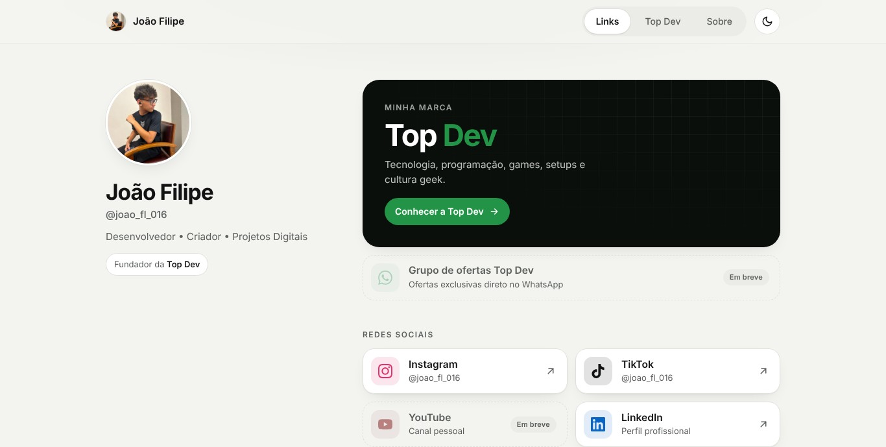

<div align="center">

# 🌐 Central de Links

Página pessoal que reúne minhas redes, meu portfólio e a Top Dev em um só lugar, com navegação entre telas, tema claro e escuro e layout para celular, tablet e computador.

</div>

---

<strong>Visão Geral do Projeto</strong>

<table>
  <tr>
    <td width="60%">

Este projeto centraliza minhas redes sociais e fortalece minha presença digital. A página inicial mostra meus links principais, o destaque da **Top Dev** e o card **Empresa Top Dev**, que leva direto para a seção de links da marca. Ao abrir a Top Dev, uma animação de transição leva para uma tela própria com site, Instagram, YouTube, TikTok, atendimento e o grupo de ofertas. Há ainda uma tela **Sobre** com minha apresentação, tecnologias e projetos.<a href="https://filiple15.github.io/projetosGerais/SiteAcessos/index.html" target="_blank"><strong>
Ver projeto </strong></a>



  </td>
  </tr>
</table>

---

<strong> 🛠️ Tecnologias Utilizadas: </strong> 

##

<details>
  <summary><strong>⚙️ Funcionalidades</strong></summary>

<br>

* Três telas em uma única página: Links, Top Dev e Sobre, com navegação por `#/` (o botão voltar do navegador funciona e cada tela tem link próprio)
* Animação de transição ao abrir a Top Dev, desativada automaticamente para quem prefere menos movimento
* Tema claro e escuro, que segue o sistema e lembra a escolha da pessoa
* Ícones em SVG, nítidos em qualquer tela e sem arquivos de imagem extras
* Layout responsivo: coluna única no celular, duas colunas de cards no tablet e perfil fixo ao lado dos links no computador
* Acessibilidade: navegação por teclado, foco visível, link para pular o conteúdo e rótulos para leitores de tela
* Prévia do link (Open Graph) para WhatsApp, Instagram e LinkedIn

</details>

##

<details>
  <summary><strong>🔗 Como ativar o grupo de ofertas</strong></summary>

<br>

O grupo de ofertas aparece na tela da Top Dev (a tela inicial leva até ele pelo card Empresa Top Dev). Enquanto não houver link, os cards mostram "Em breve".

Para ativar, abra `JS/app.js` e preencha a constante no topo do arquivo:

```js
const OFERTAS_URL = 'https://chat.whatsapp.com/SEU-LINK';
```

Todos os cards e botões do grupo passam a funcionar de uma vez.

</details>

##

<details>
  <summary><strong>📁 Estrutura</strong></summary>

<br>

```
SiteAcessos/
├── index.html      estrutura das três telas
├── CSS/style.css   temas, layout e animações
├── JS/app.js       tema, navegação e grupo de ofertas
└── img/            foto de perfil, favicon e imagem de prévia
```

</details>

##

<details>
  <summary><strong>📊 Detalhes adicionais</strong></summary>

<br>

* 📅 Data de conclusão: 02/01/2026
* 🔄 Redesenhado em: 13/11/2026
* 📦 Status: Concluído
* 🎯 Objetivo: Criação de página para divulgação de redes sociais e prática de layout, UX e JavaScript
* 🌐 Versão online: <a href="https://filiple15.github.io/projetosGerais/SiteAcessos/index.html" target="_blank">Acessar projeto</a>

<br>

<a href="https://github.com/Filiple15/projetosGerais">📃 Repositório</a>

</details>

---

<details>
  <summary><strong>👨‍💼 Sobre o criador</strong></summary> 
  <br>

<strong>Dev. Junior</strong>
Focado na construção de interfaces modernas e na evolução contínua como desenvolvedor, transformando projetos simples em experiências bem estruturadas.

🔗 <a href="https://github.com/Filiple15">GitHub</a>

</details>
